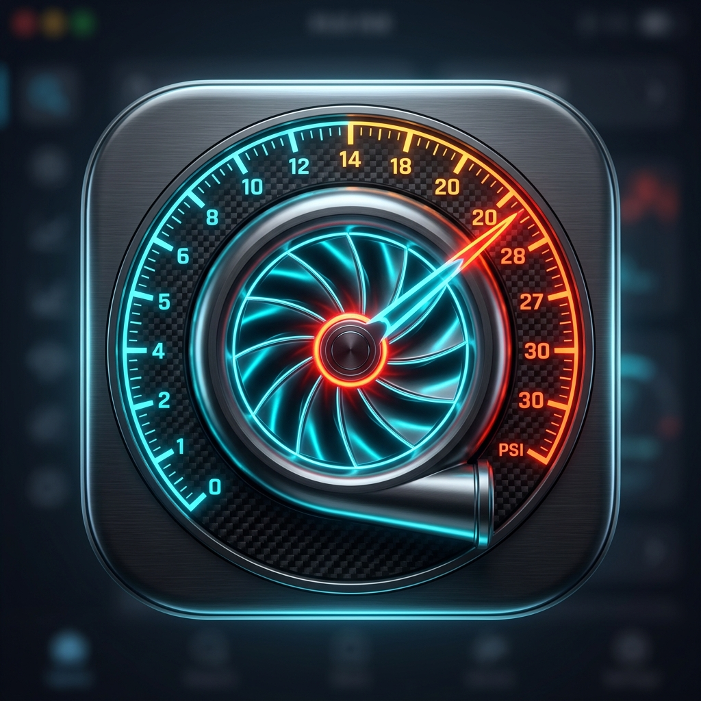

# 🚀 Teste de Pressão — App Android de Telemetria e Diagnóstico OBD2

Aplicação Android desenvolvida em **Kotlin** e **Jetpack Compose** para monitorização em tempo real de turbocompressor, teste de saúde da bateria de 12V, leitura avançada de códigos específicos da BSI e Peugeot, computador de bordo, teste de aceleração dos 0 aos 100 km/h e ferramentas dedicadas ao **Peugeot 508 II (2020)**.

---

## 🏎️ Funcionalidades Principais (Versão 1.3.0)

### 1. Monitor & Teste de Saúde da Bateria 12V (Novo!)
* **Diagnóstico Dedicado ao Peugeot 508:**  
  O sensor inteligente BECB da Peugeot corta o Start&Stop e força o ecrã a entrar no aviso de *"Modo Economia de Energia"* sempre que a bateria desce abaixo de ~70% de carga.
* **Medição da Tensão de Repouso (Open-Circuit):**
  * $\ge 12.6\text{ V}$: 100% Carga (Excelente)
  * $12.4\text{ V} - 12.5\text{ V}$: ~75% a 85% Carga (Boa)
  * $12.1\text{ V} - 12.3\text{ V}$: Bateria fraca (causadora do corte elétrico da carrinha)
  * $< 12.0\text{ V}$: Crítica / Risco de não pegar
* **Teste de Arranque (Cranking Test):**
  * Regista a queda mínima de tensão no exato instante em que dá à chave para o motor pegar. Se a tensão descer abaixo de $9.4\text{ V}$, indica perda de corrente de arranque (CCA) e células degradadas.
* **Tensão do Alternador em Andamento:**
  * Confirma se o alternador inteligente está a carregar entre $13.8\text{ V}$ e $14.8\text{ V}$.

### 2. Leitor de Avarias Específico PSA / BSI (Novo!)
* **Comunicação UDS com a BSI (`0x752`):**
  * Ao contrário das apps genéricas que só leem erros genéricos `P0xxx`, a app interroga diretamente a BSI e o calculador do motor através do serviço UDS **`19 02 FF`**.
  * **Códigos B (Carroçaria / BSI):** Identifica erros de fecho central, inibição de Start&Stop por bateria fraca (`B1805`), relé de potência da BSI (`B1624`), etc.
  * **Códigos P1xxx (Motor PSA):** Identifica falhas de velas de incandescência (`P1351`), bomba de aditivo Eolys/FAP (`P1434`), catalisador AdBlue/SCR (`P20EE`), etc.
  * **Códigos U (Rede CAN):** Erros de comunicação entre a BSI, o quadrante digital e o ecrã tátil.

### 3. Computador de Bordo & Gravador de Viagens
* **Cálculo de Consumo:** Consumo instantâneo e médio em **L/100 km** em andamento; comuta para **L/h** com o carro parado.
* **Avaliação de Condução:** Classifica cada trajeto em **🍃 Económica**, **⚡ Dinâmica** ou **🏎️ Desportiva**.
* **Histórico de Trajetos:** Registo de quilómetros, tempos, litros gastos e pico de turbo atingido.

### 4. Manómetro de Pressão de Turbo em Tempo Real (Universal)
* Leitura em tempo real do sensor MAP (`010B`) subtraindo a pressão atmosférica (`0133`).
* Manómetro desportivo circular (-1.00 a +3.00 Bar) com ponteiro de pico (*Peak Hold*).

### 5. Grelha de Sensores com Filtros & Otimização
* Leitura de Temperatura do Óleo (`015C`), Tensão (`0142`), Carga do motor (`0104`), Temperatura de admissão (`010F`), Acelerador (`0111`) e MAF (`0110`).
* Interruptores para ativar/desativar sensores individuais.

### 6. Cronómetro 0 aos 100 km/h
* Deteção de arranque automático com medição ao milissegundo e gravação do melhor tempo.

### 7. Ecrã Sempre Ligado & Atualizações In-App
* Opção de manter o ecrã ligado durante a condução.
* Atualização com 1 clique a partir do GitHub através do separador **Definições**.

---

## 📦 Como Atualizar no Telemóvel:

1. Se já tem a app instalada, abra o separador **Definições** e toque em **"Verificar Atualizações"**!
2. Ou faça o download direto do ficheiro **`TesteDePressao.apk`** a partir do repositório GitHub.
